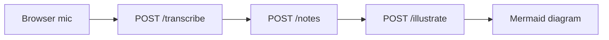

# Lakar

**Speak it. Sketch it.**

Lakar turns speech into structured notes and a diagram. Record your voice in the browser, and get a transcript, a summary with key points and action items, and either a mind map or a flowchart. It handles Malay, English, and mixed Malay/English ("Manglish") speech.

*Lakar* is Malay for "to sketch".

## Features

- **Speech to text** with a one-click mic button, using OpenAI `gpt-4o-transcribe`
- **Mixed-language support:** Malay, English, and code-switching between them
- **Structured notes:** title, summary, key points, action items, validated against a schema
- **Two diagram types:** mind map or flowchart, switchable without re-recording
- **Plain-language errors:** short or silent recordings get a helpful message, not a stack trace

## How it works



1. The browser records audio with `MediaRecorder` and uploads it.
2. `/transcribe` converts the audio to text.
3. `/notes` asks an LLM for structured JSON that matches a Pydantic schema.
4. `/illustrate` asks the LLM for a structured tree (mind map) or graph (flowchart). The server then **writes the Mermaid code itself**.

## Design decisions

- **The LLM never writes diagram code.** It returns structured data, and the server renders the Mermaid text. Labels are sanitised, node IDs are generated by the server, and edges pointing at missing nodes are dropped, so a malformed diagram can't reach the browser.
- **Structured outputs, not text parsing.** Notes and diagrams are validated with Pydantic, so bad model output fails clearly with a 502 instead of breaking the UI.
- **Swappable speech provider.** Transcription sits behind a small interface and a factory, so another engine (for example a local `faster-whisper`) can be added without changing the routers.
- **Untrusted output stays untrusted.** The front end uses `textContent` for LLM text, and limits are enforced in code, not only in prompts.
- **Fast, free tests.** The LLM is replaced with a fake in tests, so the suite needs no API key.

## Tech stack

Python, FastAPI, Pydantic, OpenAI API, Mermaid, vanilla HTML/JS, Docker, pytest

## Getting started

Requires Python 3.12+ and an OpenAI API key.

```bash
git clone https://github.com/apizkayyy/lakar.gi
cd lakar
python -m venv .venv
source .venv/bin/activate        # Windows (Git Bash): source .venv/Scripts/activate
pip install -r requirements.txt
cp .env.example .env             # then add your OPENAI_API_KEY
uvicorn app.main:app --reload
```

Open http://localhost:8000 in Chrome, click the mic, speak, and click again to stop.

> The microphone only works on `localhost` or HTTPS.

## Configuration

Set these in `.env`:

| Variable | Default | Description |
|---|---|---|
| `OPENAI_API_KEY` | none | Your OpenAI API key (required) |
| `STT_PROVIDER` | `openai` | Speech-to-text provider |
| `STT_MODEL` | `gpt-4o-transcribe` | Transcription model |
| `NOTES_MODEL` | `gpt-4o-mini` | Model used for notes and diagrams |
| `MAX_UPLOAD_MB` | `25` | Maximum audio upload size |

## API

Interactive docs are at http://localhost:8000/docs.

| Endpoint | Input | Output |
|---|---|---|
| `GET /health` | none | `{"status": "ok"}` |
| `POST /transcribe` | audio file (multipart), optional `language` | `{"transcript": "..."}` |
| `POST /notes` | `{"transcript": "..."}` (min 20 characters) | title, summary, key points, action items |
| `POST /illustrate?style=mindmap\|flowchart` | the notes JSON | Mermaid code plus the structured data |

Try the whole chain from the command line:

```bash
curl -s -F "file=@meeting.mp3" http://localhost:8000/transcribe \
  | curl -s -X POST http://localhost:8000/notes -H "Content-Type: application/json" -d @- \
  | curl -s -X POST http://localhost:8000/illustrate -H "Content-Type: application/json" -d @- \
  | jq -r .mermaid
```

## Project structure

```
app/
├── main.py              # app setup and routing
├── config.py            # environment-based settings
├── schemas.py           # Pydantic models
├── routers/             # health, transcribe, notes, illustrate
├── providers/stt/       # speech-to-text interface and OpenAI implementation
├── services/            # notes and diagram generation
└── static/index.html    # web front end
tests/
```

## Tests

```bash
pytest
```

## Docker

```bash
docker build -t lakar .
docker run -p 8000:8000 --env-file .env lakar
```

## Roadmap

- [ ] Save sessions and show a history list (SQLite)
- [ ] Meeting mode: capture a Google Meet or Zoom browser tab, transcribe in chunks
- [ ] Notes for long recordings (summarise in parts, then combine)
- [ ] Upload an existing recording
- [ ] Telegram bot
- [ ] AI-generated sketchnote image

## Privacy

Audio and transcripts are sent to OpenAI for processing. Get everyone's consent before recording a conversation, and check your organisation's policy before using it on confidential meetings.

## License

MIT